# InvoiceFlow

Multi-tenant invoicing and client management software designed for service businesses, agencies, and independent professionals. Built with **Laravel 13, PostgreSQL, React 19, Inertia.js, and Tailwind CSS 4**, InvoiceFlow delivers strict multi-company data isolation, integer-precision financial calculations, automated payment workflows, PDF generation, and AI-assisted invoice authoring.

---

## Table of Contents

- [Overview](#overview)
- [Screenshots & Application Preview](#screenshots--application-preview)
- [Key Features](#key-features)
  - [Implemented Core Modules](#implemented-core-modules)
  - [Planned Capabilities](#planned-capabilities)
- [Technology Stack](#technology-stack)
- [Architecture & Design Principles](#architecture--design-principles)
  - [System Flow](#system-flow)
  - [Directory Structure](#directory-structure)
- [Prerequisites](#prerequisites)
- [Installation & Setup](#installation--setup)
- [Running the Application](#running-the-application)
  - [Demo Accounts](#demo-accounts)
- [Database Schema & Entity Relationships](#database-schema--entity-relationships)
- [Testing & Quality Gates](#testing--quality-gates)
- [Environment Variables](#environment-variables)
- [Contributing](#contributing)
- [License](#license)

---

## Overview

InvoiceFlow eliminates common invoicing pain points—such as floating-point rounding errors, tenant data leakage, and manual collection follow-ups—through a disciplined architectural foundation:

1. **Strict Multi-Tenancy**: Every business operates within an isolated workspace. Global query scopes enforce tenant boundaries at the ORM layer, preventing unauthorized cross-company access.
2. **Integer Minor Unit Currency**: Monies are stored and computed in integer minor units (paise/cents). Calculations utilize half-up bankers rounding on line items, guaranteeing ledger consistency between the server and PDF invoices.
3. **Server-Authoritative Business Logic**: Totals, taxes, discounts, and status lifecycles are computed strictly in dedicated service layers (`app/Services/`), never in controllers or client-side components.
4. **Resilient Background Processing**: Queue workers manage asynchronous invoice email dispatching, PDF document rendering, and Stripe checkout webhook reconciliation without blocking HTTP requests.
5. **Built-in Automation**: Daily cron schedulers mark overdue accounts and trigger automated reminder notices on 3-, 7-, and 14-day milestones.

---

## Screenshots & Application Preview

All screenshots below represent the actual, running application populated with the demo seed data.

### Operational Dashboard
Financial overview displaying current monthly revenue, outstanding receivables, overdue amounts, KPI trends, and action lists.
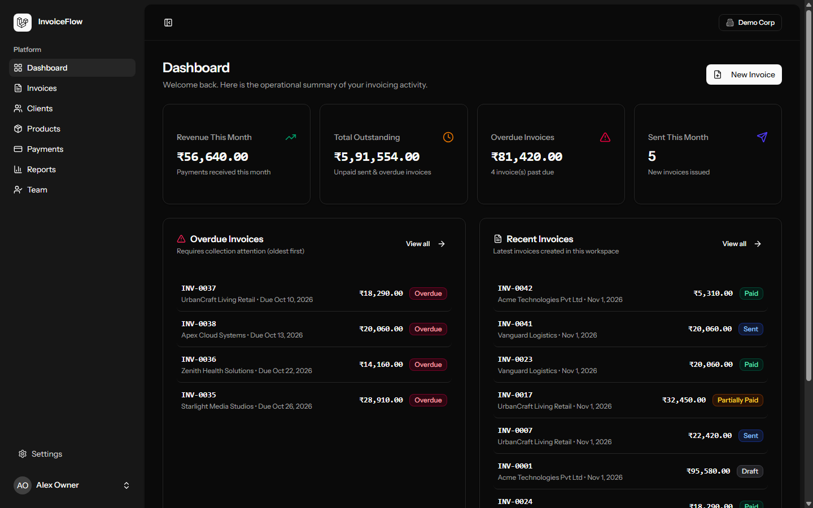

### Invoice Management
Real-time list of invoices with status tabs (`draft`, `sent`, `partially_paid`, `paid`, `overdue`, `void`), search filters, and fast actions.
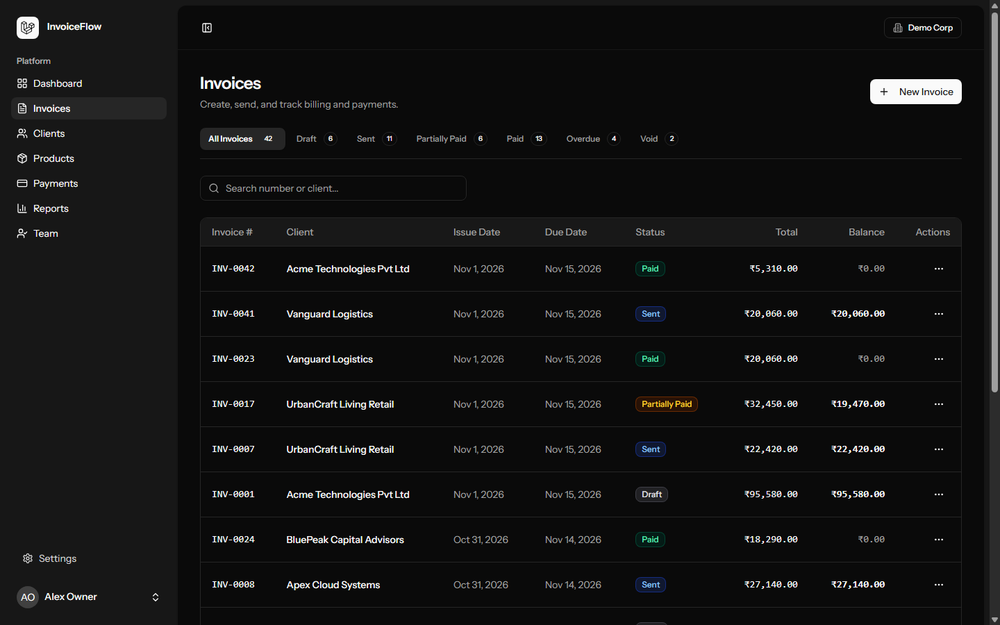

### Customer Directory & Accounts
Tenant-scoped client directory with pagination, search, contact details, and balance summaries.
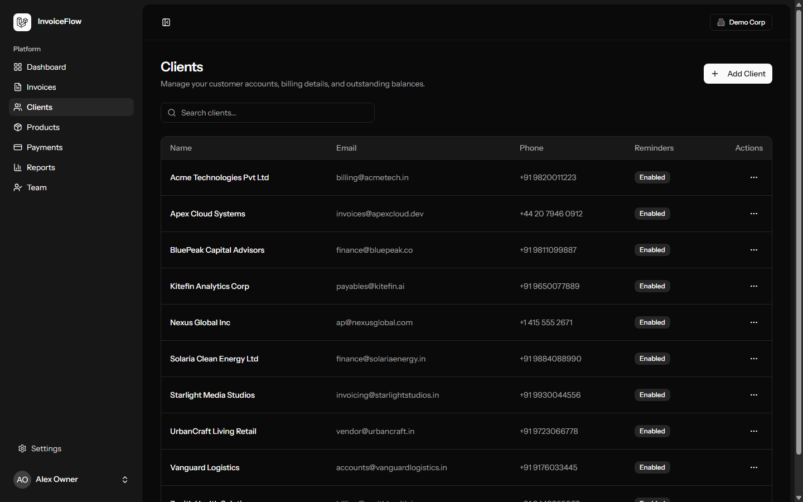

### Client Profile & Billing History
Detailed client profile showing cumulative billed volume, outstanding account balance, reminder settings, and linked invoice history.
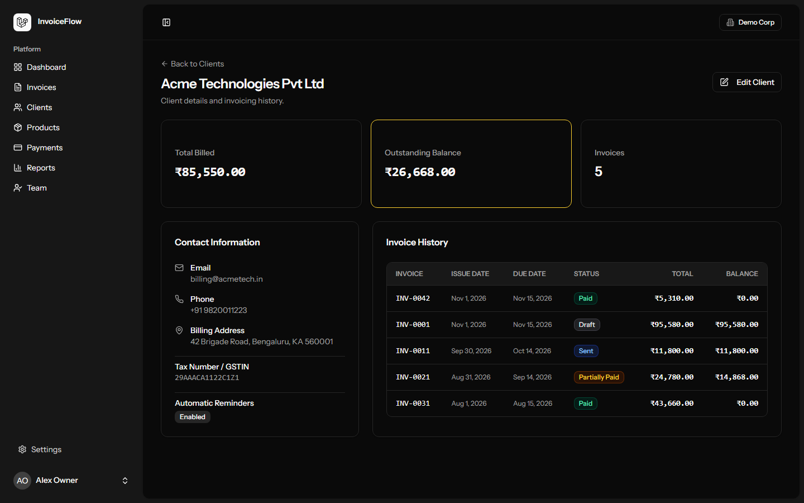

### Financial Reports & Analytics
Cash collection trajectories, invoice status distributions, receivables aging breakdowns (0-30, 31-60, 61-90, 90+ days), and CSV exports.
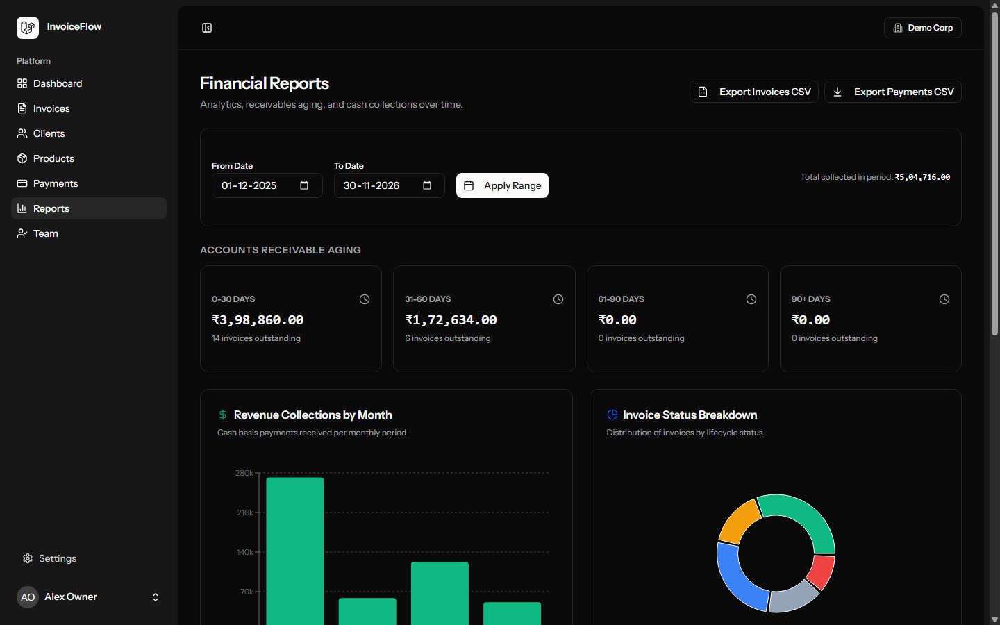

### Payment Tracking
Complete transaction log across all settlement methods (Bank Transfer, Credit Card, Cash, Stripe) with balance verification.
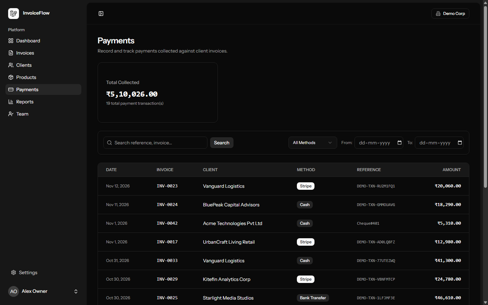

### Public Client Payment Portal
Guest-facing, signed payment link allowing clients to view invoice details, download verified PDFs, and settle balances via Stripe.
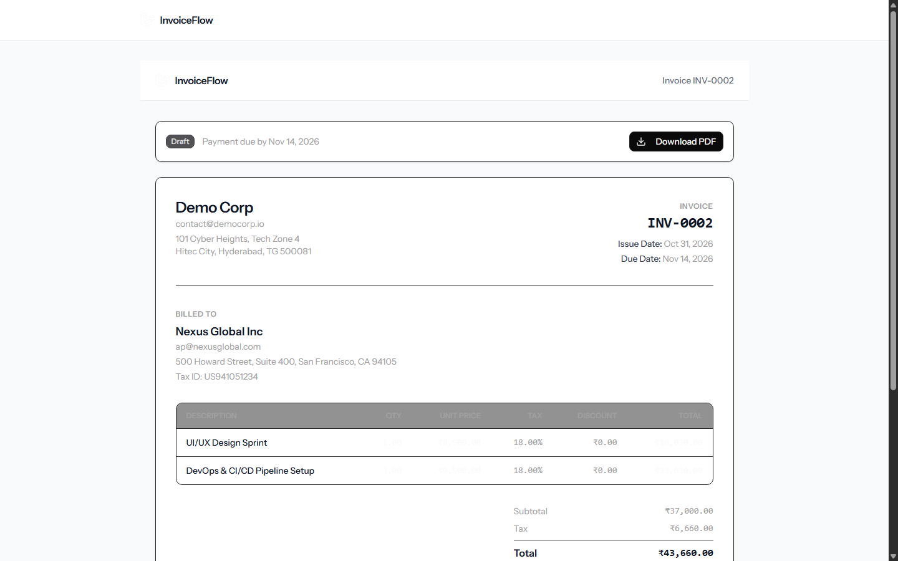

### Authentication & Workspace Registration
Built on Laravel Fortify with session authentication, role assignment, and workspace initialization in a single database transaction.
| Sign In | Workspace Registration |
|---|---|
| 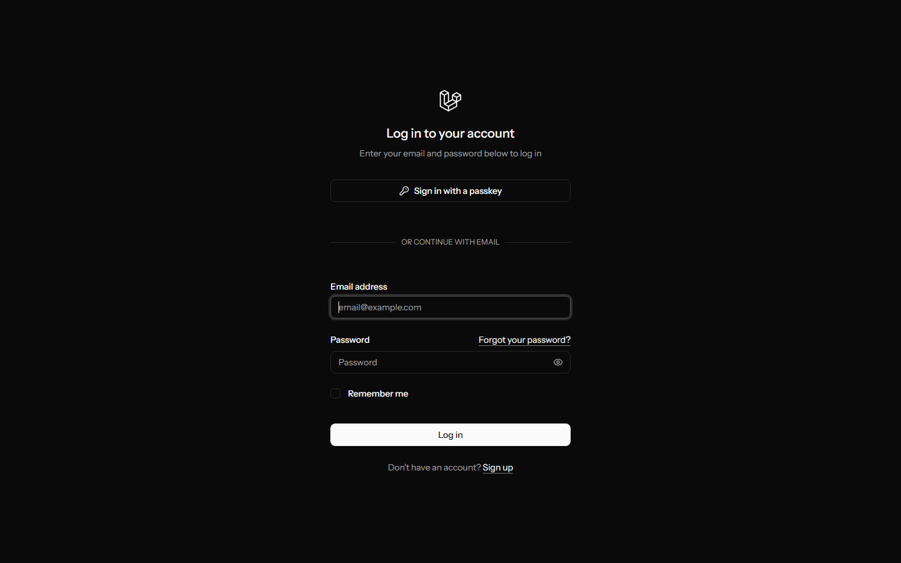 | 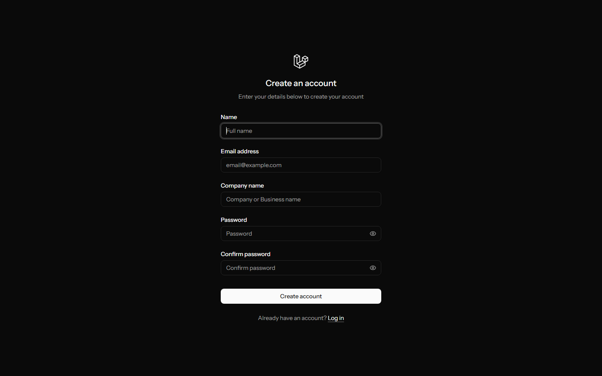 |

---

## Key Features

### Implemented Core Modules

- **Workspace Multi-Tenancy & RBAC**
  - Instant workspace creation on registration (`Owner`, `Accountant`, `Staff` roles).
  - Global query scoping via `BelongsToCompany` trait and `TenantManager` singleton.
  - Safe company switcher allowing users to belong to multiple organizations.
  - Team member invitation flow with copyable tokens and 48-hour expiration.
  - Last-owner deletion protection and role authorization policies.

- **Invoice Engine & Builder**
  - Interactive invoice draft builder with dynamic line items, product auto-completion, and tax calculation.
  - Server-side recalculation on save with half-up rounding (`InvoiceCalculator`).
  - Thread-safe, non-colliding sequential invoice numbering via database row locking (`InvoiceNumberGenerator`).
  - Formal status transition machine (`draft` → `sent` → `partially_paid` / `paid` / `overdue` / `void`).
  - Invoice duplication, voiding with reason tracking, and client-side draft auto-calculations.

- **PDF & Communication Engine**
  - DomPDF Blade template rendering with UTF-8 character support (DejaVu Sans) and status watermark stamps.
  - Asynchronous background email queue (`SendInvoiceEmail`) with exponential retry backoff.
  - Responsive Markdown invoice emails with direct download attachments and public guest payment links.

- **Payment Processing & Webhook Deduplication**
  - Manual payment recording with balance locking and overpayment prevention.
  - Stripe Checkout Session integration via public invoice portal (`/i/{token}/checkout`).
  - CSRF-exempt webhook endpoint (`/webhooks/stripe`) with cryptographic signature verification.
  - Idempotent event processing backed by `webhook_events` tracking table to eliminate duplicate charge entries.

- **Automated Scheduling & Reminders**
  - Daily overdue state updater (`invoices:mark-overdue` running at 01:00 UTC).
  - Automated reminder dispatcher (`invoices:send-reminders` running at 09:00 UTC) triggering emails at 3, 7, and 14 days overdue.
  - Idempotent `invoice_reminders` tracking table to ensure each milestone email is sent at most once.
  - Client-level reminder opt-out toggle (`send_reminders`).
  - Event-driven dashboard cache busting on invoice dispatch, payment logging, and status transitions.

- **Financial Analytics & Reporting**
  - Aggregate SQL reports grouped by PostgreSQL `date_trunc` intervals.
  - Dashboard KPI caching with role-based revenue masking for `Staff` accounts.
  - Receivables aging schedule categorized across 0-30, 31-60, 61-90, and 90+ day intervals.
  - Memory-efficient streamed CSV exports for invoices and payments.

- **REST API v1**
  - Token-based API authentication powered by Laravel Sanctum.
  - Role-derived token capabilities (`*`, `read`, `write`, `invoices:create`, etc.).
  - Token management dashboard (`/settings/api-tokens`) with revocation controls.
  - Tenant-scoped API endpoints for Clients, Products, Invoices, and Payments.
  - Rate limiting enforced at 60 requests per minute.

- **AI Invoice Draft Assistant**
  - Natural-language draft generator modal ("Create with AI") in the invoice builder.
  - Strict JSON output parsing and prompt injection sanitization.
  - Fuzzy client matching without unverified customer record generation.
  - Daily per-company rate limit cap (50 requests/day) and request audit logging (`ai_requests`).

---

### Planned Capabilities

The following items are scheduled for future milestone releases:
- Recurring invoice generation with configurable billing cron schedules.
- Multi-currency conversions with live exchange rate feeds.
- Row-Level Security (RLS) enforcement at the PostgreSQL database engine layer.
- Interactive OpenAPI / Scribe API interactive documentation.
- Additional payment provider integrations (Razorpay, PayPal).

---

## Technology Stack

| Layer | Technology | Purpose |
|---|---|---|
| **Backend Framework** | [Laravel 13](https://laravel.com/) (PHP 8.3+) | Core routing, Eloquent ORM, authentication, middleware, CLI |
| **Frontend Architecture** | [React 19](https://react.dev/) + [Inertia.js v2](https://inertiajs.com/) | Client SPA without client-side routing overhead |
| **Language & Typings** | [TypeScript](https://www.typescriptlang.org/) | Strict end-to-end interface definitions |
| **Styling & Components** | [Tailwind CSS 4](https://tailwindcss.com/) + [shadcn/ui](https://ui.shadcn.com/) | Responsive UI components, theme tokens, Lucide icons |
| **Database** | [PostgreSQL 16+](https://www.postgresql.org/) | Relational storage, atomic transactions, row-level locking |
| **Data Visualization** | [Recharts](https://recharts.org/) | Interactive bar charts and donut graphs |
| **PDF Generation** | [barryvdh/laravel-dompdf](https://github.com/barryvdh/laravel-dompdf) | Server-rendered PDF documents |
| **Payment Processing** | [Stripe PHP SDK](https://github.com/stripe/stripe-php) | Stripe Checkout Session creation and webhook verification |
| **Testing Suite** | [Pest 3](https://pestphp.com/) | Expressive unit and feature test automation |
| **Code Formatting** | [Laravel Pint](https://laravel.com/docs/pint) | Automated PSR-12 and Laravel code style enforcement |

---

## Architecture & Design Principles

### System Flow

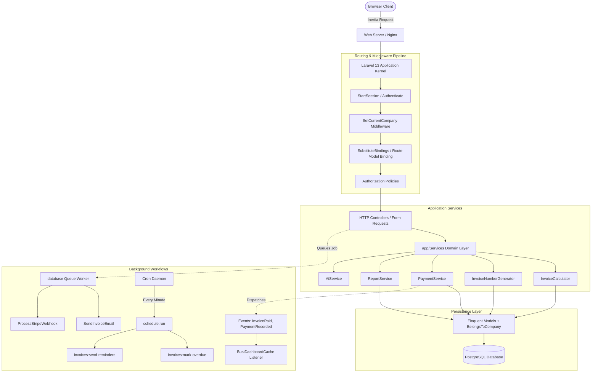

### Directory Structure

```text
invoiceflow/
├── app/
│   ├── Enums/                 # Domain enums (InvoiceStatus, PaymentMethod, Role)
│   ├── Http/
│   │   ├── Controllers/       # Thin controllers dispatching to domain services
│   │   ├── Middleware/        # SetCurrentCompany, HandleInertiaRequests
│   │   └── Requests/          # Validated FormRequests with strict rule definitions
│   ├── Models/                # Eloquent models implementing BelongsToCompany
│   ├── Policies/              # Granular role-based authorization policies
│   ├── Services/              # Domain logic (Billing, Payments, Reports, Tenancy, AI)
│   └── Support/Concerns/      # BelongsToCompany multi-tenant global scoping trait
├── bootstrap/                 # Application bootstrap & middleware priority configuration
├── config/                    # Framework and application settings
├── database/
│   ├── factories/             # Model factories for realistic testing fixtures
│   ├── migrations/            # Version-controlled PostgreSQL database schemas
│   └── seeders/               # DemoSeeder with complete, multi-month transactional data
├── docs/                      # Technical specifications, schema references, screenshots
├── resources/
│   ├── css/                   # Tailwind CSS 4 theme rules and base layers
│   ├── js/
│   │   ├── components/        # shadcn/ui primitives and shared domain components
│   │   ├── layouts/           # AppSidebarLayout, AuthLayout, PublicLayout
│   │   ├── lib/               # Money formatting, date handling, utility functions
│   │   ├── pages/             # Inertia.js React view pages
│   │   └── types/             # TypeScript interfaces for domain entities
│   └── views/                 # Root Inertia Blade template & DomPDF invoice view
├── routes/
│   ├── api.php                # REST API v1 routes with Sanctum authentication
│   ├── console.php            # Scheduled console commands (mark-overdue, send-reminders)
│   └── web.php                # Web routes for SPA views, webhooks, and public guest pages
└── tests/                     # 160+ Pest unit and feature integration test cases
```

---

## Prerequisites

Ensure your development environment meets the following specifications:

- **PHP**: `^8.3` or `>= 8.5` (cli)
  - Required extensions: `pdo_pgsql`, `mbstring`, `openssl`, `bcmath`, `gd`, `zip`, `curl`, `intl`
- **PostgreSQL**: `16.0` or higher
- **Node.js**: `^22.0` or `>= 24.0` (with `npm`)
- **Composer**: `^2.7` or higher

---

## Installation & Setup

Follow these steps to configure and boot InvoiceFlow locally:

### 1. Clone Repository & Install Dependencies

```bash
git clone https://github.com/your-username/invoiceflow.git
cd invoiceflow

# Install PHP dependencies
composer install

# Install frontend dependencies
npm install
```

### 2. Configure Environment

```bash
cp .env.example .env
php artisan key:generate
```

Edit your `.env` file and set your PostgreSQL credentials:

```env
APP_NAME=InvoiceFlow
APP_ENV=local
APP_DEBUG=true
APP_URL=http://localhost:8000

DB_CONNECTION=pgsql
DB_HOST=127.0.0.1
DB_PORT=5432
DB_DATABASE=invoiceflow
DB_USERNAME=postgres
DB_PASSWORD=your_password

QUEUE_CONNECTION=database
CACHE_STORE=database
SESSION_DRIVER=database
```

### 3. Provision Database & Run Migrations

Create the application and testing databases:

```bash
# PostgreSQL CLI or psql terminal
createdb -U postgres invoiceflow
createdb -U postgres invoiceflow_test
```

Run migrations and seed the comprehensive demo workspace:

```bash
php artisan migrate --seed
```

### 4. Compile Frontend Assets

```bash
# Build production bundle
npm run build

# Or run Vite development server
npm run dev
```

---

## Running the Application

InvoiceFlow utilizes Laravel's integrated `dev` script to run the PHP development server, background queue worker, and Vite HMR server concurrently:

```bash
composer run dev
```

The application will be accessible at: **`http://localhost:8000`**

### Task Scheduler (Optional for Local Testing)

To test scheduled overdue invoice status updates and reminder emails locally, run the scheduler worker in a separate terminal:

```bash
php artisan schedule:work
```

---

### Demo Accounts

The database seeder provisions a fully functional workspace (**Demo Corp**) with 3 predefined user personas:

| Role | Email | Password | Permissions & Scope |
|---|---|---|---|
| **Owner** | `owner@demo.com` | `password` | Complete administrative access, team management, billing settings, API tokens |
| **Accountant** | `accountant@demo.com` | `password` | Invoices, payments, clients, products, and financial reports; no team role modification |
| **Staff** | `staff@demo.com` | `password` | Create and manage drafts, view clients and products; gross revenue metrics masked |

---

## Database Schema & Entity Relationships

The relational architecture maintains absolute tenant isolation through the `company_id` foreign key present on all domain models.

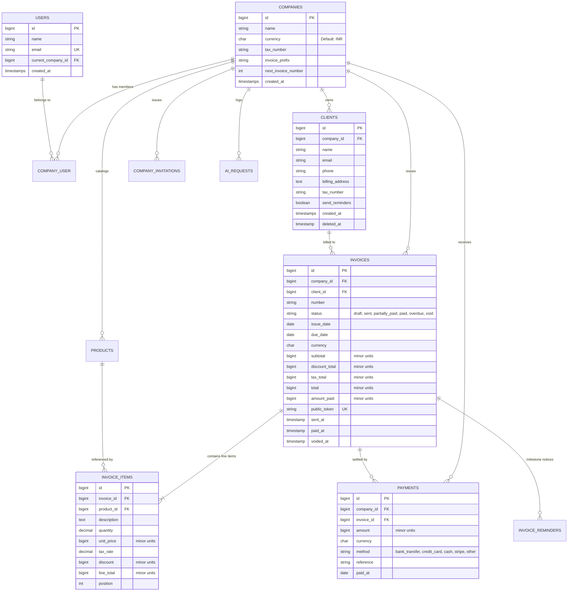

---

## Testing & Quality Gates

The project enforces automated test coverage across tenant isolation, policy matrix authorizations, payment race conditions, and invoice calculations:

```bash
# Run the complete Pest test suite
./vendor/bin/pest

# Run code style formatting check (Laravel Pint)
./vendor/bin/pint --test

# Run static TypeScript type check
npm run types

# Run production asset compilation check
npm run build
```

### Verified Test Suite Metrics
- **Total Tests Passing**: `162 passed`
- **Total Assertions**: `837 assertions`
- **N+1 Query Safeguard**: `Model::preventLazyLoading` active in development and testing environments.

---

## Environment Variables

| Variable | Description | Default / Example |
|---|---|---|
| `APP_NAME` | Name of the platform instance | `InvoiceFlow` |
| `APP_ENV` | Application environment (`local`, `production`) | `local` |
| `APP_KEY` | 32-character AES application encryption key | `base64:...` |
| `APP_DEBUG` | Detailed error reporting (disable in production) | `true` |
| `APP_URL` | Root URL for generating invoice links | `http://localhost:8000` |
| `DB_CONNECTION` | Database engine driver | `pgsql` |
| `DB_HOST` | Database server address | `127.0.0.1` |
| `DB_PORT` | PostgreSQL port | `5432` |
| `DB_DATABASE` | Target application database | `invoiceflow` |
| `DB_USERNAME` | Database user account | `postgres` |
| `DB_PASSWORD` | Database user password | `secret` |
| `QUEUE_CONNECTION` | Queue processing backend driver | `database` |
| `CACHE_STORE` | Cache storage engine | `database` |
| `SESSION_DRIVER` | Session management backend | `database` |
| `STRIPE_KEY` | Stripe publishable API key | `pk_test_...` |
| `STRIPE_SECRET` | Stripe secret API key | `sk_test_...` |
| `STRIPE_WEBHOOK_SECRET` | Stripe webhook signing secret | `whsec_...` |
| `FEATURE_AI` | Toggle AI invoice draft authoring module | `true` |
| `AI_API_KEY` | Anthropic / Google Gemini API key | `AIzaSy...` |
| `AI_DAILY_CAP` | Maximum AI requests allowed per company per day | `50` |

---

## Contributing

1. Fork the repository and create your branch from `main`:
   ```bash
   git checkout -b feature/my-new-feature
   ```
2. Implement your changes following PSR-12 and strict typing principles.
3. Ensure all tests and static analysis quality gates pass:
   ```bash
   ./vendor/bin/pint && ./vendor/bin/pest && npm run types && npm run build
   ```
4. Commit your changes using conventional commits:
   ```bash
   git commit -m "feat(module): description of feature"
   ```
5. Push to your branch and submit a Pull Request.

---

## License

This project is open-source software licensed under the [MIT License](LICENSE).
