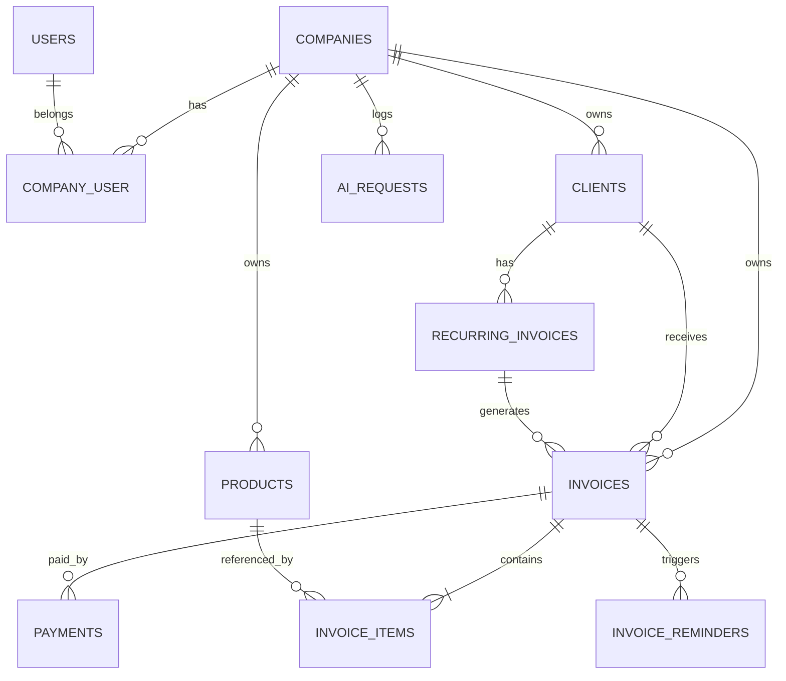

# Database Schema

Database: **PostgreSQL 16+**. All money columns are `bigInteger` in minor units (paise/cents) with a `CHECK (col >= 0)` constraint (PostgreSQL has no unsigned types). All tenant tables have `company_id` (indexed, foreign key).

## PostgreSQL Conventions
- Use `jsonb` (Laravel `$table->jsonb()`) for JSON columns
- Use `timestampsTz()` / `timestampTz()`; store UTC
- Case-insensitive unique email per company: unique index on `(company_id, lower(email))`
- Uniqueness among non-deleted rows: partial unique index, e.g. `CREATE UNIQUE INDEX ... ON clients (company_id, lower(email)) WHERE deleted_at IS NULL AND email IS NOT NULL` (use `DB::statement` in the migration)
- Search with `ILIKE`; consider `pg_trgm` GIN indexes if needed
- Statuses are plain strings cast by PHP enums (optionally add a `CHECK` constraint)

## ERD

## Tables

### companies
| Column | Type | Notes |
|--------|------|-------|
| id | bigint PK | |
| name | string | |
| email | string nullable | |
| currency | char(3) | default INR |
| tax_number | string nullable | GSTIN/VAT |
| address | text nullable | |
| invoice_prefix | string | default `INV` |
| next_invoice_number | unsigned int | default 1 |
| timestamps | | |

### users
Default Laravel columns plus `current_company_id` (nullable FK).

### company_user
| Column | Type | Notes |
|--------|------|-------|
| company_id | FK | |
| user_id | FK | |
| role | string | owner, accountant, staff |
| | | unique(company_id, user_id) |

### invitations
`id, company_id, email, role, token (unique), expires_at, accepted_at, timestamps`

### clients
| Column | Type |
|--------|------|
| id, company_id | |
| name | string |
| email | string nullable |
| phone | string nullable |
| billing_address | text nullable |
| tax_number | string nullable |
| send_reminders | boolean default true |
| deleted_at | soft delete |
| timestamps | |

Indexes: `(company_id, name)`, `(company_id, email)`

### products
`id, company_id, name, description, unit_price (bigint), tax_rate (decimal 5,2), is_active, deleted_at, timestamps`

### invoices
| Column | Type | Notes |
|--------|------|-------|
| id, company_id | | |
| client_id | FK | |
| recurring_invoice_id | FK nullable | |
| number | string | unique(company_id, number) |
| status | string | draft, sent, partially_paid, paid, overdue, void |
| issue_date | date | |
| due_date | date | |
| currency | char(3) | |
| subtotal | bigint | |
| discount_total | bigint | |
| tax_total | bigint | |
| total | bigint | |
| amount_paid | bigint | default 0 |
| notes | text nullable | |
| public_token | string unique | for signed link |
| sent_at, paid_at, voided_at | timestamps nullable | |
| void_reason | string nullable | |
| timestamps | | |

Indexes: `(company_id, status)`, `(company_id, due_date)`, `(company_id, client_id)`, `(company_id, issue_date)`

### invoice_items
`id, invoice_id, product_id (nullable), description, quantity (decimal 10,2), unit_price (bigint), tax_rate (decimal 5,2), discount (bigint), line_total (bigint), position`

Values are **snapshots**: editing a product later must not change old invoices.

### payments
| Column | Type | Notes |
|--------|------|-------|
| id, company_id, invoice_id | | |
| amount | bigint | |
| method | string | stripe, bank_transfer, cash, other |
| reference | string nullable | transaction ID |
| paid_at | timestamp | |
| recorded_by | FK users nullable | |
| timestamps | | |

### webhook_events
`id, provider, provider_event_id, type, payload (jsonb), processed_at nullable, timestamps`, **unique(provider, provider_event_id)**

### recurring_invoices (LATER, not in MVP)
`id, company_id, client_id, interval (weekly/monthly/yearly), next_run_date, ends_on nullable, template (jsonb: items, notes), is_active, timestamps`

### invoice_reminders
`id, invoice_id, days_after_due, sent_at, timestamps`, unique(invoice_id, days_after_due) so a reminder is never sent twice.

### ai_requests
`id, company_id, user_id, feature (invoice_draft/reminder/summary), model, input_tokens, output_tokens, latency_ms, status, timestamps`

### activity_log (LATER, not in MVP)
`id, company_id, user_id, subject_type, subject_id, action, properties (jsonb), created_at`

## MVP tables
companies, users, company_user, invitations, clients, products, invoices, invoice_items, payments, webhook_events, invoice_reminders, ai_requests, personal_access_tokens, plus Laravel's jobs/cache/sessions tables.

## Seeding Order
companies, users, company_user, clients, products, invoices + items, payments.

## Migration Tips
- One migration per table, in dependency order
- Add foreign keys with `constrained()->cascadeOnDelete()` only where deletion should cascade
- Test migrations against PostgreSQL (never SQLite) so behavior matches production
- Add indexes in the same migration, not later
- Never edit a migration that has been deployed; add a new one
